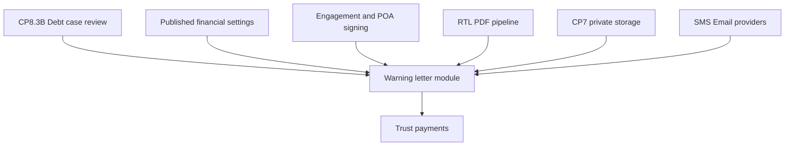

# CP8.4A — Warning letter system architecture and implementation plan

**Status:** Planning and audit only (CP8.4A + alignment pass before CP8.4B). No application code, collections, or integrations in these checkpoints.

**Date:** 2026-10-16 (alignment pass)

---

## Source document status (read first)

| Source | Status | Use in this plan |
|--------|--------|------------------|
| `docs/cp8-warning-letter-lawyer-answers.md` | Present (2026-10-16) | **Authoritative workflow Q&A** (30 answers). Legal letter prose remains **`warning-letter-sample.docx`**. |
| `docs/תשובות לשאלות של עומר.docx` | Present | **Primary in-repo Q&A.** Extracted 2026-10-16: **five numbered topics** (פתיחת תיק, פרטי חייב, בדיקת עו״ד, כפילויות/הרשאות, המשך טיפול) — **not** 30 discrete Q&A rows. Covers letter workflow, approve/send intent, balance letters, channels, statuses. |
| `docs/warning-letter-sample.docx` | Present | **Authoritative sample prose and layout** — full body text extracted; `word/header1.xml` + `word/footer1.xml` (letterhead/footer assets); `word/media/` (`image1.png`–`image4.jpeg`); numbered list via Word `numId` (see §4.1). |
| `docs/cp8-debt-case-management-plan.md` | Present | Domain alignment, CP8 scope boundaries, conflict table seeds. |
| `docs/cp8.2-debt-case-persistence.md` | Present | Implemented persistence facts. |
| `docs/cp7-secure-document-infrastructure.md` | Present | Document storage boundary (deferred). |
| `docs/cp6d-vat-inclusive-pricing.md` | Present | Financial settings semantics. |
| `docs/אפיון מערכת מכתבי התראה – שיפוטי בבניין (2).docx` | Present | **Product/spec supplement** (Oct 2026): template variants with/without treatment fee, MC vs committee client line, delivery channels, billing table (**277 ₪ + VAT** parameter — conflicts with sample **327 incl. VAT**; see §6). |

---

## 1. Executive summary

VaadClick will add a **warning-letter module** that turns **lawyer-approved debt cases** into **versioned, immutable letter artifacts** and **controlled dispatch**, without bypassing the three business principles:

1. **Simple for operators** — submit debt case; see clear statuses; no legal template editing.
2. **Lawyer controls legal and financial decisions** — separate steps for case review, draft approval, dispatch authorization, and money movement.
3. **Payment only via case-specific trust link** — never to committee/MC directly.

**Today (post CP8.3B):** debt cases can be drafted, submitted, and **reviewed** (approve for letter prep / return / reject). **No** warning-letter entity, **no** PDF generation, **no** dispatch, **no** payments, **no** private blob storage.

**Recommended path:** small checkpoints **8.4B → 8.4C → 8.4D**, then delivery/payments/evidence in later CPs once storage, signing, and providers exist.

---

## 2. Existing architecture audit (Part 1)

Legend: **Implemented** · **Partial** · **Planned** · **Missing**

### 2.1 Debt-case statuses and transitions

| Capability | Status | Evidence |
|------------|--------|----------|
| `workflowStatus` (draft, awaiting review, returned, rejected, closed_manual, letter_sent reserved) | **Implemented** | `debt-case-status-transitions.ts`, Mongoose model |
| `lawyerReviewStatus` (not_submitted, pending, approved_for_letter_prep, returned, rejected) | **Implemented** | Same |
| Operator submit / resubmit | **Implemented** | `debt-case.service.ts`, portal actions |
| Lawyer return / reject / approve-for-letter-prep | **Implemented** | `debt-case-review.service.ts`, admin UI CP8.3B |
| Transition to `letter_sent` / post-letter lifecycle | **Missing** | Enum reserved; no service/UI |
| `legalHoldReasons` on case | **Partial** | Stored on approve; not full stop-condition product |
| Period-claim duplicate prevention | **Implemented** | `debt_case_period_claims`, transactional submit |
| `predecessorDebtCaseId` / post-letter new case | **Partial** | Field in domain plan; verify usage in model for CP8.4B |

**Reuse:** `debt-case-status-transitions`, `debt-case-review.service`, `debt-case.service`, authorization, audit, period claims.

### 2.2 Lawyer review vs letter dispatch

| Step | Status | Notes |
|------|--------|-------|
| Approve case for **letter preparation** | **Implemented** | Does **not** send letter; UI states this explicitly |
| Block approve when building not ready | **Partial** | Approve **succeeds** but copies `holdReasons` onto case when `legalTreatmentAllowed === false` (`approveDebtCaseForLetterPrep`) — does **not** block approval |
| Approve-and-send combined action | **Missing** (planned UX) | Lawyer DOCX + Oct spec: **“אשר ושלח”** for ordinary unflagged cases; **server must still record** separate draft approval, immutable snapshot, dispatch authorization, and evidence (composite action, not a single conflated status). |
| Letter draft / approve draft / authorize dispatch | **Missing** | New module |
| Automatic draft when case qualifies | **Missing** | Required: after `approved_for_letter_prep` + readiness gates (and auto-checks), system **creates draft** without lawyer click (lawyer DOCX flow: submit → checks → lawyer approval → letter). |

### 2.3 Legal readiness gates

| Input | Status | Notes |
|-------|--------|-------|
| Building `lawyerVerificationStatus` | **Partial** | Read in `loadBuildingLegalReadinessForDebtCase`; **VERIFIED** transition may still be guarded elsewhere (see CP8 plan) |
| Committee engagement `signedAt` | **Partial** | Read; often null in dev |
| POA signed | **Missing** | Hard-coded `poaSigned = false` in loader |
| `legacyFastTrackEligible` | **Partial** | On building model; affects `streamlinedReviewEligible` only |
| `evaluateBuildingLegalReadiness` | **Implemented** | `debt-case-legal-readiness.ts` |
| Case-level holds (dispute, insolvency, death, bank change) | **Partial** | Enum exists; operator/lawyer set flows **not** fully productized |

**Reuse:** `loadBuildingLegalReadinessForDebtCase`, `DebtCaseLegalHoldReason`, readiness result in lawyer detail UI.

### 2.4 Documents and PDF

| Capability | Status |
|------------|--------|
| `document-assets` module (classifications, auth, audit) | **Partial** — infra only |
| Private storage / upload / download | **Missing** (CP7 deferred) |
| Malware scan | **Missing** |
| Warning-letter classification in enum | **Planned** (reserved in CP7 docs) |
| Hebrew RTL PDF generation | **Missing** |
| DOCX mail-merge | **Missing** |

### 2.5 Monetary fields and snapshots

| Capability | Status |
|------------|--------|
| Case `principalAmountMinor` (agorot) | **Implemented** |
| Interest/indexation on warning letter | **Out of scope v1** (lawyer DOCX + sample) |
| Published **financial settings** (debtor treatment fee gross/net/VAT, committee waived fee) | **Implemented** (CP6D) |
| Per-letter **immutable monetary snapshot** | **Missing** |
| Payment ledger / trust account | **Missing** |
| Case-specific payment link | **Missing** |

### 2.6 Payments and trust

| Capability | Status |
|------------|--------|
| Trust account collection | **Missing** |
| Partial payment allocation (expenses first, then principal) | **Planned** (lawyer answers + prompt); **no code** |
| Direct-to-committee payment report | **Missing** (lawyer describes behavior) |
| SMS-gated committee cost actions | **Missing** |

### 2.7 Audit

| Capability | Status |
|------------|--------|
| Mandatory audit on debt-case mutations | **Implemented** |
| Taxonomy: created, submitted, returned, rejected, approved_for_letter_prep, review_invalidated | **Implemented** |
| Letter/dispatch/payment audit events | **Missing** (extend taxonomy in later CP) |

### 2.8 Notifications / messaging

| Capability | Status |
|------------|--------|
| Email/SMS/WhatsApp providers | **Missing** |
| Manual WhatsApp (`wa.me`) queue | **Missing** (design only) |

### 2.9 Building verification and signing

| Capability | Status |
|------------|--------|
| Building verification workflow | **Partial** |
| Digital engagement/POA signing | **Missing** |
| Committee engagement terms display | **Partial** (admin UI) |

### 2.10 Services to reuse (summary)

- **Domain:** debt-case enums, transitions, parties, validation flags, legal hold reasons, edit policy.
- **Services:** `debt-case.service`, `debt-case-review.service`, `debt-case-authorization.service`, `debt-case-audit.service`, `debt-case-period-claim.service`, `lawyer-debt-case-query.service`, legal readiness loader.
- **Financial:** published financial settings query (for treatment fee snapshot at letter freeze).
- **Documents (later):** `document-asset.service` + storage adapter when configured.
- **Auth:** existing role and building-scope helpers.

---

## 3. Confirmed business rules (in-repo sources only)

Rules below are traced to **`docs/תשובות לשאלות של עומר.docx`**, **`docs/warning-letter-sample.docx`**, and **`docs/אפיון מערכת מכתבי התראה – שיפוטי בבניין (2).docx`** unless marked **unverified**. Items that appear only in the missing **`cp8-warning-letter-lawyer-answers.md`** or conversation are **not** confirmed here.

### Letter and case lifecycle

1. **One initial warning letter per debt case** (max one `initial_warning` artifact); resending the **same immutable PDF** is a new **dispatch attempt**, not a new letter type.
2. **One open case per apartment/debtor** until initial letter sent; merge debt into existing case before send; after send — new linked case (`predecessorDebtCaseId`).
3. **Balance letter (`balance_letter`):** permitted after qualifying **partial payment** or **direct payment on principal** (lawyer DOCX §5); requires **separate lawyer approval**; **no additional treatment expenses** on balance letters.
4. **Draft generation:** when a case is **approved for letter prep**, passes readiness gates, and has no blocking holds, the system **automatically** builds an internal draft from template + snapshots (no operator action).
5. **Lawyer send control:** no letter leaves the system without **explicit lawyer authorization** (lawyer DOCX §3, §5). **Bulk approve** only for cases **without exception flags** (lawyer DOCX + Oct spec).
6. **UX vs internals:** for an ordinary unflagged case, the lawyer UI may expose one **“Approve and send”** control that orchestrates draft approval + snapshot + dispatch authorization in one confirmed step; **persist separate audit records** for each internal stage.
7. **Flagged cases** (validation flags, legal holds, readiness gaps): **individual** lawyer review — no bulk send.

### Financial (letter-facing)

8. **Principal:** from debt case `principalAmountMinor` at snapshot time; **no interest or indexation** in the **initial** warning letter (lawyer DOCX §2).
9. **Treatment expenses (debtor):** added to letter total **only** when the building is **eligible** for treatment-fee charging (Oct spec: registration flag “יש בסיס להוצאות טיפול”; exact field in code TBD in CP8.4B). Amount = **`debtorTreatmentFeeGross`** (and derived net/VAT) from the **published financial-settings version** frozen on the letter snapshot — **never hardcoded** in the rendering engine (sample shows **327 ₪ כולל מע״מ** as an example only).
10. **Committee waiver charge:** **`committeeTreatmentFeeWhenDebtorWaivedGross`** (lawyer DOCX: **200 ₪ + מע״מ** via SMS-gated waiver) is **billing to the committee**, **not** a line item on the debtor’s warning letter and **not** merged into debtor treatment fee logic.
11. **Do not mutate** historical published financial settings; new commercial amounts require a **new published version** with lawyer action (CP6D).
12. **Payments (when integrated):** exclusively via **case-specific trust-account payment link**; sample + lawyer flow prohibit paying committee/MC directly; partial payments allocate **treatment expenses first, then principal** (prompt/spec — implement in payment CP, not CP8.4B).

### Delivery and evidence (design — not CP8.4B)

13. **Channels (v1 intent):** WhatsApp **manual** first; SMS/email automated after authorization (Oct spec); registered mail for pre-suit notice later.
14. **10 days** to pay (lawyer DOCX §5); **printed deadline vs receipt wording** remains **unresolved** (§7) — **blocks legally operative final PDF/dispatch**, not CP8.4B HTML preview.
15. **Joint owners:** one letter listing all; separate delivery to each relevant mobile (lawyer DOCX §2).
16. **Tenant debtor:** one letter; send to tenant and **copy owner**; owner mobile required (lawyer DOCX §2).
17. **After initial letter sent:** case debt fields frozen; operator may report direct payment, dispute, stop — other changes via lawyer.
18. **Retention ≥7 years:** cited in CP8.4A prompt — **not** found in extracted in-repo Q&A; **requires lawyer confirmation** before retention policy is coded.

---

## 4. Letter template specification (Part 2)

**Source of truth for Hebrew legal prose:** `docs/warning-letter-sample.docx` (initial warning) plus Oct spec for **variants not shown in the sample** (committee-only intro, template **without** treatment-fee clause). CP8.4B stores prose in a **versioned manifest** — no AI paraphrase, no reconstructed paragraphs.

### 4.1 Sample DOCX structure (extracted 2026-10-16)

**Layout / assets (package inspection, read-only)**

| Asset | Location |
|-------|----------|
| Letterhead | `word/header1.xml` — embedded drawing (image) |
| Footer | `word/footer1.xml` — embedded drawing |
| Body images | `word/media/image1.png` … `image4.jpeg` (signature/stamp) |
| Numbering | `word/numbering.xml` — auto-numbered body clauses (`numId`) |
| Typography | David, RTL, justified (from DOCX styles) |

**Fixed blocks (variable placeholders in `{braces}`)**

| # | Block | Sample text (abridged) / notes |
|---|--------|--------------------------------|
| A | Addressee + date | `לכבוד:` … `{debtorNames}`; `תאריך: {letterDate}` |
| B | Address | `{street} {buildingNo} דירה מס' {apartment}` / `{city}` |
| C | Channel label | `{deliveryChannelLabel}` e.g. `רשום/הודעת ווטסאפ` (underline in Word) |
| D | Subject | `הנידון: {buildingAddress} - מכתב התראה בטרם נקיטת הליכים משפטיים` |
| E | Representation intro | See §4.1.1 — **MC vs committee** |
| F–N | Numbered clauses | See §4.1.2 — **renumber when clauses omitted** |
| O | Debt table | **Aggregate** only in sample (§4.1.3) |
| P | Payment block | Highlighted; trust link; anti-direct-pay (§4.1.4) |
| Q | Contact | `054-9001774` → `{lawOfficeMobile}` from config |
| R | Signature | `עו״ד צבי הרשל אשכנזי` + `{barNumber}` (`3901440190500` in sample) + images |
| S | Evidence disclaimer | Lines beginning `***** יודגש כי…` (page break before in DOCX) |

#### 4.1.1 Representation intro variants

**Sample (management company)** — single paragraph opening:

> הריני לפנות אלייך בשם חברת הניהול {managementCompanyLegalName}/הנציגות (להלן: "מרשתי") ונציגות הבית המשותף ברח' {street} מס' {buildingNo}, בעיר {city} (להלן: "מייפת הכוח"), ובהיותי בא-כוחה המשפטי, ולהתריע כדלקמן:

**Oct spec (committee, MC as operator only):** client line = **נציגות הבית המשותף** at building address; optional **"באמצעות חברת הניהול {name}"** — **separate manifest branch**, lawyer must approve exact strings before publish.

#### 4.1.2 Numbered clauses (initial warning — from sample body)

Clauses below are the **ordered manifest** for the MC+ treatment-fee sample. Omitted clauses (no treatment fee; owner-only vs tenant) **drop rows** and **renumber** 1…n.

1. **Ownership / occupancy:** `{ownerClause}` **or** `{tenantClause}` — sample combines: *"בבעלותך המשותפת… (מגורים) **או לחלופין** הנך שוכר/ת… (מחזיק/ה בפועל)"* — product may split into **mutually exclusive** variants per lawyer confirmation (combined vs split wording).
2. **MC maintenance role:** *"חברת הניהול (מרשתי) מנהלת את האחזקה…"* — **omit or rephrase** when client is committee-only (Oct spec).
3. **Non-payment despite prior contact:** *"חוב… אינו משולם כסדרו, חרף פניות קודמות…"*
4. **Debt intro + table lead-in:** *"להלן פירוט סכומי החוב, קרן בלבד… כולל מע\"מ:"* — table follows.
5. **Legal basis (s. 58):** *"חובת תשלום… סעיף 58(א) לחוק המקרקעין…"*
6. **10-day demand (receipt-based wording):** *"…ארכת חסד של 10 ימים **ממועד קבלת מכתב זה**."* — **conflicts** with printed calendar date in clause 8 (§7).
7. **Treatment expenses (conditional):** *"מכתב זה מחייב בתשלום הוצאות טיפול עו\"ד על סך כולל של **{treatmentFeeGrossDisplay}** (כולל מע\"מ)… החוב הכולל… **{totalWithTreatmentDisplay}**."* — `{treatmentFeeGrossDisplay}` from **financial snapshot**, not literal `327`.
8. **Lawsuit threat:** *"…ככל שהחוב לא ייפרע במלואו ובמועד, תישקל נקיטת הליכים משפטיים…"*
9. **Good-faith opportunity:** *"מכתב זה יהווה ראיה… הזדמנות נאותה…"*
10. **Prior contacts documented:** *"מכתב זה נשלח לאחר שפניות קודמות…"*
11. **Printed deadline + no second warning:** *"…בתוך 10 ימים, **עד לתאריך {printedDeadlineDate}**, תוגש תביעה… **לא תישלח התראה נוספת.**"* — `{printedDeadlineDate}` rule **TBD** (§7).
12. **Payment instructions (highlight):** *"…סך כולל של {totalDisplay} (קרן {principalDisplay} + הוצאות {treatmentDisplay})… **קישור התשלום… {paymentLinkPlaceholder}**… אין לשלם… לוועד… תשלום חלקי… לא יביא לסגירת התיק…"*
13. **Closing + signature block** (assets from template version).

**Balance letter:** separate template version (Oct spec: “התראה לפני תביעה” / continuation letters) — **out of CP8.4B** scope except reserved `letterType` and manifest hook.

#### 4.1.3 Debt table (aggregate — sample)

| Column | Sample |
|--------|--------|
| Header | `מספר חודשי פיגור` / `סכום חוב` |
| Row | `סה"כ 4 חודשים` / `1,224 ₪` |
| Total | `סה״כ : 1,224 ₪` |

Lawyer DOCX: month-by-month breakdown **not required**; optional future column layout if lawyer adds it.

#### 4.1.4 Payment and evidence lines (must preserve)

- Trust account via **personal payment link** (placeholder in sample: `[קישור תשלום]`).
- **Explicit ban** on paying committee/MC; partial payment does not close file.
- Final `*****` block: claims documented by client; exhibits withheld at this stage but available in litigation.

**Ambiguous / lawyer sign-off before template publish**

- Combined owner+tenant sentence vs split variants.
- Committee-only intro when no MC on building.
- Whether Oct spec line *"אם לדעתך החוב אינו נכון…"* belongs on **initial** warning PDF (in spec, not in sample DOCX).
- Gendered Hebrew (`אלייך`) vs neutral forms for mixed/joint debtors.

### 4.2 Template versioning strategy

| Element | Approach |
|---------|----------|
| Legal prose | Stored as **versioned template bundle** (`warning_letter_template_versions`) — immutable once published; lawyer approves version id |
| Variables | Structured snapshot JSON (not live case pointers) at draft/approve time |
| Conditional sections | Rule engine keys: `clientType`, `legalDebtorDesignation`, `treatmentFeeEligible`, `deliveryChannelLabel`, `occupancyType` |
| DOCX vs PDF | **Authoring:** lawyer-maintained DOCX/HTML master → **render** to PDF for dispatch; CP8.4B may use HTML+CSS RTL prototype before pixel-perfect DOCX parity |
| Placeholders requiring lawyer sign-off | MC vs committee intro strings; tenant dual-address wording; exact lawsuit deadline sentence (receipt vs date); whether month table is mandatory |

### 4.3 Letter types

| Type | Rules |
|------|--------|
| **Initial warning** (`initial_warning`) | Max **one** per debt case; creates immutable `letter_sent` snapshot on dispatch |
| **Balance letter** (`balance_letter`) | Only when business rules satisfied (partial pay, direct pay on principal, etc.); **separate** lawyer approval; **no** new treatment fee; does not replace initial letter |
| **Resend same PDF** | Same artifact + new dispatch attempt records — **not** a new letter type |

---

## 5. Draft lifecycle (Part 3)

### 5.1 Separate concerns (mandatory)

| Stage | Actor | System meaning |
|-------|--------|----------------|
| Case review approve | Lawyer | `lawyerReviewStatus = approved_for_letter_prep` — **internal** readiness only |
| Draft generation | System (+ lawyer trigger) | Creates `warning_letter_drafts` row — **not** sent |
| Draft preview / manual edit | Lawyer | Exception path; `manuallyEdited = true` + audit diff metadata |
| Draft approve | Lawyer | Locks draft content snapshot + template version |
| Dispatch authorize | Lawyer | Explicit action per channel/recipient |
| Dispatch record | System / lawyer manual claim | Evidence row — honest status (manual WA ≠ delivered) |
| Delivery evidence | Provider / upload | Updates delivery state when proof exists |

**Invariant:** `approved_for_letter_prep` **does not** imply dispatch authorized.

### 5.2 Proposed draft lifecycle

```
approved_for_letter_prep + gates pass + no blocking holds
  → system auto-creates draft v1 from template + snapshots
  → preview (lawyer)
  → optional manual edit (lawyer) → audit
  → lawyer approves draft → immutable approved snapshot hash
  → lawyer authorizes dispatch (per recipient/channel)
  → generate final PDF (if not already) → store as DocumentAsset (when storage live)
  → record dispatch + update case workflow to letter_sent (initial only)
```

**Invalidation:** material case edit (operator resubmit changing parties/principal/period) **invalidates** open drafts; require regeneration; audit link to `debt_case.review.invalidated_by_edit` pattern.

**Idempotency keys:** `(debtCaseId, letterType=initial)` unique; `(draftId, recipientId, channel, attemptNo)` for dispatch; lawyer confirm dialog + server idempotency token on authorize.

### 5.3 Duplicate prevention

- DB unique partial index: one **non-terminal** initial letter per `debtCaseId`.
- Dispatch: status machine `scheduled → in_progress → sent | failed | cancelled`; no double-submit without new attempt record.
- Payment webhooks: idempotent on provider event id (future).

---

## 6. Financial rules and conflict table (Part 4)

| # | Existing rule (code/docs) | New lawyer answer / sample | Conflict? | Proposed resolution | Lawyer confirm? |
|---|---------------------------|----------------------------|-----------|---------------------|-----------------|
| F1 | CP6D: letter engine reads **`debtorTreatmentFeeGross`** (+ frozen net/VAT) from **published financial-settings version** at snapshot time; **no code default / no hardcoded 327** | Sample letter **displays 327 ₪ כולל מע״מ** as example typography | **None** if published settings match sample | Snapshot stores `settingsVersionId`, `debtorTreatmentFeeGrossMinor`, derived net/VAT; preview renders snapshot only | **Yes** — lawyer must **publish** gross amount (e.g. 32700 agorot) when ready; sample alone does not change settings |
| F2 | **`committeeTreatmentFeeWhenDebtorWaivedGross`** — committee billing on SMS waiver (lawyer: **200 ₪ + מע״מ**) | Must not appear on debtor letter | None | Keep separate module/billing; never add to `{totalDisplay}` on warning letter | No for CP8.4B |
| F3 | Oct spec billing table: **277 ₪ + VAT** debtor treatment parameter | Sample + CP6D gross-inclusive **327** example | **Yes — documentary** | Do **not** silently reconcile specs; treat Oct spec table as stale until lawyer republishes settings + confirms template | **Yes** |
| F4 | CP6D: immutable published versions; no backfill | Letter must not rewrite historical settings rows | None | New commercial fee → **new publish** only | No |
| F5 | Partial allocation: **expenses then principal** (prompt) | Not in extracted DOCX chunk | Planned | Payment CP only; letter snapshot frozen | **Yes** when payments built |
| F6 | Payment link shows **current outstanding balance** (prompt) | Immutable sent letter amounts | **Yes** | Sent PDF fixed; link landing page dynamic | Design OK if UI explains |
| F7 | Direct payment report freezes principal; balance letter on expenses | Lawyer DOCX §4–5 | Planned | Workflow CP after letters | No for 8.4B |
| F8 | VAT display “כולל מע״מ” on sample treatment line | Gross-inclusive publish model | Align | Snapshot stores gross + derived net/vat for invoice later | No |

**CP8.4A / alignment:** no payment splitting, trust movements, or **automatic** financial-settings changes in code. CP8.4B may **read** published settings for snapshot tests only.

---

## 7. Deadline and delivery dates (Part 5)

### 7.1 Observed inconsistency (sample)

- Clause text: **10 days from receipt** of letter (`ממועד קבלת מכתב זה`).
- Same letter: **printed deadline date** (`עד לתאריך 29.4.26`) computed from **letter date 19.4.26** (+10 calendar days).

### 7.2 Safe modeling (pending lawyer confirmation)

| Date type | Source | Use |
|-----------|--------|-----|
| `letterDate` | Lawyer-approved draft / PDF | Printed on letter |
| `draftApprovedAt` | Audit | Internal SLA |
| `dispatchAuthorizedAt` | Audit | Start dispatch workflow |
| `dispatchRecordedAt` | Manual/provider | **Not** legal receipt |
| `deliveryConfirmedAt` | Provider proof / registered mail upload | **Candidate** receipt for legal countdown |
| `paymentDeadlineDate` | **TBD rule** | Printed deadline |
| `lawsuitReadyAt` | System timer | **Auto status only** — **no auto filing** |

**Options for lawyer (pick one):**

- **A:** Printed date = `letterDate + 10 calendar days`; clause text adjusted to match issue date (not receipt).
- **B:** Printed date blank until **delivery confirmed**; clause stays receipt-based.
- **C:** Dual display — issue-based date **and** receipt-based clause (current sample) — lawyer confirms legally acceptable.

**Do not** treat payment-link open as receipt.

**Implementation gate:** until the lawyer selects **A, B, or C**, production **final PDF** generation and **dispatch** must not compute `{printedDeadlineDate}` or lawsuit-ready timers from assumptions.

**Escalation:** after deadline passes without full payment → case flag `ready_for_lawsuit_consideration` (lawyer DOCX flow); **no** automated court filing.

---

## 8. Delivery architecture (Part 6)

### 8.1 Channel adapter pattern

```
warning_letter_dispatch_service
  → channel_adapter (whatsapp_manual | sms | email | registered_mail)
  → recipient_snapshot (name, mobile, email, role: debtor|owner_copy)
  → dispatch_attempt record
```

### 8.2 WhatsApp (v1 — no API)

- Lawyer admin queue: `wa.me` link with URL-encoded message + PDF link (when storage exists).
- **One manual send action per recipient**; lawyer confirms “I sent”.
- Status: `manual_send_claimed` — **not** `delivered`.
- Dedicated sending number (config).

### 8.3 SMS / email (future)

- Provider adapter interface; webhook handlers for delivery/open **when provider sends events**.
- Auto-send only after **dispatch authorize** + readiness gates + idempotency.

### 8.4 Registered mail (future)

- Printable PDF + envelope; tracking number field; delivery confirmation upload → manual status with audit.

### 8.5 Recipients

- Snapshot at **draft approve** or **dispatch authorize** (later of material contact changes).
- Joint owners: one letter PDF; N dispatch rows.
- Tenant: primary to tenant; **owner copy** dispatch row(s).

---

## 9. Legal readiness and stop conditions (Part 7)

| Condition | Source of truth | Set by | Blocks draft? | Blocks draft approve? | Blocks dispatch? | Blocks escalation? | Override |
|-----------|-----------------|--------|---------------|----------------------|------------------|-------------------|----------|
| Building not verified | `building.lawyerVerificationStatus` | Lawyer admin | Recommend | **Yes** | **Yes** | — | No statutory bypass |
| Engagement unsigned | `committee_engagement.signedAt` | Signing CP (future) | Recommend | **Yes** | **Yes** | — | No |
| POA unsigned | Future POA model | Signing CP | Recommend | **Yes** | **Yes** | — | No |
| Declaration unsigned | Not modeled | — | — | — | — | — | **TBD** in missing Q&A |
| Debt dispute | `legalHoldReasons` / case flag | Operator report + lawyer | Warn | **Yes** | **Yes** | **Yes** | Lawyer clears dispute hold only |
| Insolvency | Hold enum | Operator/lawyer | **Yes** | **Yes** | **Yes** | **Yes** | Manual process |
| Death | Hold enum | Operator/lawyer | **Yes** | **Yes** | **Yes** | **Yes** | Manual estate track |
| Direct pay reported | Future payment report | Operator | — | — | Partial | Balance letter path | Lawyer |
| Payment arrangement honored | Future | Lawyer | — | — | Reminders paused | — | Lawyer |
| Client stop request | Future | Operator/lawyer | — | — | **Yes** | **Yes** | Lawyer final say |
| Bank change unapproved | Hold enum | System | — | — | Letters may send (lawyer: blocks **transfers** only) | Blocks transfer | Lawyer approves bank |
| Material case change | Case revision | Operator edit | Invalidates draft | — | — | — | Regenerate |

**“Only lawyer can release”** applies to **case holds and workflow decisions**, not to **unsigned POA/engagement** — those require documents, not a universal override flag.

---

## 10. PDF, evidence, storage, retention (Part 8)

| Item | Plan |
|------|------|
| RTL PDF | Server-side renderer (HTML→PDF or dedicated Hebrew engine); match approved sample layout in CP8.4D |
| Layout fidelity | Golden-file PDF tests vs lawyer-approved fixture |
| Immutability | `contentSha256`, template version id, snapshot JSON, `approvedAt`, `approvedByUserId` |
| Storage | `DocumentAsset` classification `warning_letter_final` when CP7 storage **configured**; until then local/dev-only generation without pretending production security |
| Download auth | Lawyer always; operator read-only when case in building scope + letter dispatched |
| Evidence pack | Dispatch attempts, provider webhooks, uploaded registered-mail proof, manual WA claims — **audit only** |
| Retention | `retainUntil = dispatchDate + 7 years` minimum once lawyer confirms in missing markdown |
| Tamper-evidence | Hash + audit trail; **not** claiming blockchain or court sufficiency |

---

## 11. Operator and lawyer UX (Part 9)

### 11.1 Operator (extend existing portal)

- Case detail: **letter status** pill (none / draft pending / approved / dispatched / failed).
- Show dispatch date/channel when available; **PDF download** only when authorized.
- Action-required: returned case, failed dispatch (read-only notice), dispute acknowledgment.
- **No** template edit; **no** approve/send.

### 11.2 Lawyer (extend admin debt-case + new sub-routes)

- Queue: cases **approved for prep** without initial letter; filter flagged exceptions.
- Detail tabs: case | **letter draft** | dispatch | evidence.
- Actions: preview auto-generated draft, manual edit (exception), **approve and send** (unflagged — composite internal steps), or separate approve draft / authorize dispatch when flagged; record manual WA send (later CP); balance letter workflow (later).
- Failed / overdue lists (later CP).

Reuse: `AdminPageFrame`, status badges, debt-case query services, audit readers.

---

## 12. Proposed models and schemas (high level)

New collections (names tentative):

### `warning_letter_template_versions`

- `templateVersionId`, `letterType`, `localeHe`, `publishedAt`, `clauseManifest[]`, `assetRefs` (header, stamp), `status`

### `warning_letter_drafts`

- `warningLetterId`, `debtCaseId`, `letterType`, `templateVersionId`, `status` (generating|ready|invalidated|approved)
- `contentSnapshotJson`, `contentSha256`, `manuallyEdited`, `financialSnapshot` (`settingsVersionId`, `debtorTreatmentFeeGrossMinor`, net/VAT when eligible; **never** committee waiver fee), `recipientPlanSnapshot`
- `revision`, audit refs

### `warning_letter_dispatch_attempts`

- `attemptId`, `warningLetterId`, `recipientSnapshot`, `channel`, `status`, `providerPayload`, `manualClaimByUserId`, timestamps

### `debt_case_payment_links` (future)

- `linkToken`, `debtCaseId`, `outstandingMinor`, trust account config ref

Extend **`debt_cases`:**

- `initialWarningLetterId`, `letterSentAt`, `debtSnapshotAtLetter` (subdocument, write-once)
- Optional `workflowStatus` transition to `letter_sent`

---

## 13. State machines (summary)

### 13.1 Warning letter draft

`none → generating → ready → approved → (dispatch pipeline) → closed`  
`ready → invalidated` on case material change.

### 13.2 Dispatch attempt

`pending_authorization → authorized → in_progress → completed | failed | cancelled`  
Manual WA: `authorized → manual_claimed`.

### 13.3 Case workflow (incremental)

Add guarded transition: `awaiting_lawyer_review` (or post-approve state) → **`letter_sent`** only via dispatch service when initial letter completes.

---

## 14. Authorization matrix (letter module)

| Action | Lawyer | Rep | MC |
|--------|--------|-----|-----|
| View letter status on case | ✓ | ✓ scoped | ✓ scoped |
| Download sent PDF | ✓ | ✓ if dispatched | ✓ if dispatched |
| Generate/approve draft | ✓ | — | — |
| Manual edit draft | ✓ | — | — |
| Authorize dispatch | ✓ | — | — |
| Record manual WA sent | ✓ | — | — |
| Balance letter | ✓ | — | — |

Enforce in **server services** only.

---

## 15. Dependency map (Part 10)



### Build now (no paid providers)

- Template schema + snapshot builder (mock PDF/HTML preview)
- Draft lifecycle + lawyer UI shell with fake preview
- Audit taxonomy extension (design)
- Status UX on operator/lawyer case detail

### Blocked

- Production PDF storage/download (storage + scanning)
- Auto SMS/email
- Live payment links
- POA/engagement gates fully green in prod (signing CP)

### Lawyer confirmation required

- Deadline rule (Part 5)
- 327 ₪ vs financial settings
- Fast-track “existing customer” vs readiness gates for **dispatch**
- Declaration document scope
- Retention period formalization

---

## 16. Implementation checkpoints (recommended)

| CP | Scope |
|----|--------|
| **CP8.4B** | Deterministic **template manifest** + **snapshot builder** (case, building, published financial settings, eligibility flags) + **Hebrew RTL HTML preview** + conditional clause inclusion/renumbering + unit/golden-string tests — **no send, no payment link, no production PDF/storage, no Mongo collections required if pure domain module acceptable** |
| **CP8.4C** | Draft lifecycle, lawyer preview/edit/approve, invalidation on case change, admin UI, audit events |
| **CP8.4D** | PDF generation parity with sample, immutable hash, document-asset integration **when storage configured** |
| **CP8.4E** | WhatsApp manual dispatch queue + honest status |
| **CP8.5+** | Payments/trust link, partial pay, balance letter automation, SMS/email adapters, lawsuit-ready timers |

*(Alternative split acceptable if POA/signing storage forces reorder.)*

---

## 17. Test strategy

- **Template:** clause inclusion/exclusion permutations (MC vs committee, tenant vs owner, treatment fee on/off); Hebrew snapshot golden strings.
- **Lifecycle:** cannot dispatch without approved draft; cannot second initial letter; invalidation on case revision.
- **Finance:** snapshot uses published settings version; no live case mutation after send.
- **Auth:** matrix tests for lawyer vs operator.
- **Audit:** mandatory failure rolls back draft approve (same pattern as debt-case review).
- **PDF (8.4D):** visual/regression optional; hash stability required.
- **Integration:** Mongo transactions for draft approve + case `letter_sent` — optional flag like existing debt-case integration tests.

---

## 18. Open questions requiring lawyer approval (prioritized blockers)

Only items that **block implementation beyond CP8.4B preview** or **legally operative dispatch/PDF**:

1. **Payment deadline rule (§7):** receipt-based clause vs `{printedDeadlineDate}` from letter date — pick **A / B / C** before final PDF or dispatch.
2. **Published treatment fee:** confirm next **gross-inclusive** `debtorTreatmentFeeGross` on a published financial-settings version (sample **327 ₪** is not a code default).
3. **“Existing customer” fast path** (lawyer DOCX §1): does it bypass **dispatch/readiness** gates or only streamline **case review**? Affects auto-draft and “approve and send”.
4. **Declaration / unified signing bundle** (Oct spec §תהליך 1): which elements are **hard gates** for **first** warning dispatch vs later escalation — signing CP not implemented.
5. **Template variants:** committee-only intro; combined vs split owner/tenant clause; optional “החוב אינו נכון” line on initial letter.

**Documentation gap (does not block CP8.4B):** export **`docs/cp8-warning-letter-lawyer-answers.md`** if a separate “30 answers” corpus exists outside the five-topic DOCX.

---

## 19. CP8.4B scope and acceptance criteria

**In scope**

- Domain module (or equivalent) that:
  - Loads **versioned template manifest** for `initial_warning` (prose copied from approved sample branches).
  - Builds **`WarningLetterContentSnapshot`** from debt case parties/principal/period, building address, client type (MC vs committee), occupancy, **`treatmentFeeEligible`**, and **published financial-settings version** (gross debtor treatment fee when eligible).
  - Applies **conditional clause inclusion** and **deterministic renumbering** (with/without treatment fee; MC vs committee intro; owner vs tenant branches as manifest keys).
  - Renders **RTL Hebrew HTML preview** (dev-only) matching snapshot strings — not pixel-perfect PDF.
  - Computes **`contentSha256`** over canonical snapshot JSON for tests.
- **Automated tests:** permutation matrix for clause sets; snapshot uses settings version id; **no literal 327** in template source; totals = principal + snapshot treatment gross when eligible.
- **Explicit non-goals:** dispatch, WhatsApp/SMS/email, payment URLs, trust ledger, Mongo persistence (optional), production PDF, private storage, lawyer UI beyond a dev/test harness if any.

**Acceptance**

- Given fixture case + building + published settings, preview HTML contains **exact manifest sentences** with substituted placeholders.
- Omitting treatment eligibility removes treatment clause and **renumbers** subsequent clauses.
- Changing published gross in fixture changes rendered fee **without code change**.
- Documented dependency on unresolved §7 dates: preview may show `{printedDeadlineDate}` as explicit placeholder until rule chosen.

---

## 20. Validation history

| Checkpoint | Application code | Docs |
|------------|------------------|------|
| CP8.4A initial | None | Created `cp8-warning-letter-system-plan.md` |
| CP8.4A alignment (2026-10-16) | None | Updated plan from DOCX re-extraction + user alignment rules |
| **CP8.4B** (2026-10-16) | Template manifest, snapshot builder, HTML preview | `cp8-warning-letter-lawyer-answers.md`, §21 below |

Consistency re-checked against `src/modules/debt-cases/`, `financial-settings/` (CP6D gross publish), `committee-engagements/`, `document-assets/` (storage off).

---

## 21. CP8.4B implementation record

### Modules and files

| Area | Path |
|------|------|
| Lawyer answers (30) | `docs/cp8-warning-letter-lawyer-answers.md` |
| Domain | `src/modules/warning-letters/domain/*` |
| Template manifest | `src/modules/warning-letters/templates/initial-warning-clause-manifest.ts` |
| Snapshot | `src/modules/warning-letters/snapshot/*` |
| HTML preview render | `src/modules/warning-letters/render/render-warning-letter-html.ts` |
| Server loader | `src/modules/warning-letters/services/warning-letter-preview.service.ts` |
| Admin UI | `src/modules/warning-letters/ui/*`, integrated in `LawyerDebtCaseReviewDetail.tsx` |
| Building flag | `buildings.treatmentFeeEligible` (default `false`) |
| Tests | `tests/warning-letter-snapshot.test.ts`, `tests/warning-letter-preview.service.test.ts` |

### Template version strategy

- **`initial_warning_he_v1`** — static TypeScript manifest (`INITIAL_WARNING_TEMPLATE_VERSION_ID`); prose copied from sample DOCX.
- **`balance_letter`** — type reserved; no manifest/workflow in CP8.4B.

### Snapshot schema (summary)

`WarningLetterContentSnapshot`: frozen parties/address, `clientPresentation`, monetary fields in **agorot** + display strings, `numberedClauses[]` with stable `clauseId`, `contentSha256`, recipient metadata for future dispatch. Built only from passed-in inputs (no live DB refs inside snapshot).

### Financial assumptions (implemented)

- Principal from case; treatment gross from **published** `debtorTreatmentFeeGross` when `building.treatmentFeeEligible`.
- **No** hardcoded 327 in code; committee waiver fee **excluded** from letter totals.
- Printed deadline: **letter date + 10 days** (lawyer Q17); receipt wording unchanged in clause 6.

### Known placeholders (CP8.4B)

- Payment link: `[קישור תשלום — יופעל לאחר חיבור סליקה]`
- Signature/stamp: text placeholder only (no PDF assets)
- Letterhead: firm name text block (not sample image)

### Not implemented (unchanged)

PDF generation, dispatch, payments, signing, private storage, persistent draft collection, audit events for letters, `letter_sent` transition.

### CP8.4C dependencies

- Persist drafts + invalidation on case edit
- Lawyer approve / manual edit + audit
- Optional: admin UI to set `treatmentFeeEligible` on building
- Gate preview on full legal readiness when signing CP exists

### Automated verification (CP8.4B)

- ESLint: pass
- `tsc` / Next build: pass
- Vitest: **382 passed** (includes 12 new warning-letter tests)

---

---

## 22. CP8.4C.1 + CP8.4C.2 implementation record (2026-10-16)

### CP8.4C.1 (persisted drafts)

- Mongo `warning_letter_drafts`, WH reference chain, invalidation on material edits, read-only GET on lawyer detail, regenerate/sync on approve and explicit mutation.
- Manual index migration: `docs/warning-letter-draft-index-migration.md` (drop legacy unique `letterCaseReference_1` if present).

### CP8.4C.2 (lawyer edit + legal wording approval)

| Area | Path |
|------|------|
| Editable clause allowlist + sanitization | `domain/warning-letter-editable-clause.ts`, `domain/sanitize-lawyer-clause-text.ts` |
| Snapshot override + hash | `snapshot/apply-clause-overrides-to-snapshot.ts` |
| Edit / approve / return services | `services/warning-letter-draft-edit.service.ts`, `warning-letter-draft-approval.service.ts`, `warning-letter-draft-approval-gates.ts` |
| Model fields | `manuallyEdited`, `manualClauseOverrides`, `editedClauseIds`, `concurrencyRevision`, `legalWordingApprovalStatus`, approval/return timestamps |
| Audit events | `legal_document.warning_letter_draft.edited`, `.wording_approved`, `.wording_returned` |
| Lawyer UI (single workspace, inline edit in letter) | `ui/WarningLetterLawyerDraftWorkspace.tsx`, `ui/WarningLetterDocumentView.tsx`, shared segments `render/warning-letter-document-segments.ts` |
| Preview (view mode, same renderer) | `ui/WarningLetterPreviewPanel.tsx` (snapshot, not separate HTML form) |
| Server actions | `actions/lawyer-warning-letter-draft.actions.ts` (save edits, approve wording, return, regenerate) |
| Tests | `tests/warning-letter-draft-c42.test.ts`, `tests/warning-letter-inline-edit.test.ts`, existing lifecycle tests |

**CP8.4C.2 UX (inline editing, same checkpoint):** Allowlisted clauses edit in place inside the formatted RTL letter (`view` / `edit` modes share `WarningLetterDocumentView` + segment builder; HTML export uses the same segments). Sticky toolbar: save / cancel / unsaved indicator. No-op save does not create a revision (client + `pickChangedClauseOverrides` + edit service).

**Lifecycle (wording approval ≠ dispatch)**

1. Active current draft → optional **עריכת טיוטה** → new revision (`SUPERSEDED` prior active), `manuallyEdited`, audit edit.
2. **אישור נוסח המכתב** — blocked until: case approved for letter prep, draft `active_current`, `approvalReady` (no `unapprovedTemplateVariantIds`), building legal readiness (engagement/POA signing **not implemented** — blocks with Hebrew), manual-override checkbox when edited.
3. Approved revision locked (`legalWordingApprovalStatus: approved`) — no in-place edit; **החזרה לתיקון** with reason → `returned_for_correction`, then new revision required before re-approval.
4. Material case/building/financial changes still **invalidate** or stale drafts (CP8.4C.1); no `letter_sent` / dispatch.

**Known blockers (intentional, not auto-resolved)**

- `unapprovedTemplateVariantIds` remain until lawyer/product approves template variants globally (CP8 plan §18).
- POA / unified signing bundle not implemented — `poaSigned` always false in readiness loader; approval shows explicit Hebrew blocker.
- Payment link, PDF, WhatsApp/SMS dispatch — later CPs.

**Schema/index note**

- New draft fields are backward-compatible defaults; no automatic Mongo index migration beyond CP8.4C.1.

*End of plan through CP8.4C.2.*

---

## 23. CP8 completion record (2026-10-16)

| Area | Implementation |
|------|----------------|
| Global template variant approval | `domain/warning-letter-template-variant-catalog.ts`, `infra/warning-letter-template-variant-approval.model.ts`, `services/warning-letter-template-variant-approval.service.ts`, UI `/app/admin/warning-letter-templates` |
| Legal readiness checklist | `services/warning-letter-legal-readiness-checklist.service.ts`, `ui/WarningLetterLegalReadinessChecklistPanel.tsx` |
| Operative policy gates (deadline, signing, payment, PDF, WhatsApp) | `domain/warning-letter-operative-policy.ts`, preview note in `presentation/warning-letter-preview-warnings.he.ts` |
| Finalization + delivery (manual only) | `infra/warning-letter-final-document.model.ts`, `infra/warning-letter-delivery-record.model.ts`, `services/warning-letter-finalization.service.ts`, `services/warning-letter-delivery.service.ts`, `ui/WarningLetterLifecyclePanel.tsx` |
| Audit | `legal_document.warning_letter_template_variant.approved`, `.finalized`, `.finalization_blocked`, `.delivery_recorded` |
| Preserved | CP8.4C.2 inline edit/save, legacy `concurrencyRevision` matching, draft revision immutability |

**Intentional production blockers:** operative deadline reconciliation; POA/e-sign; CP7 private PDF storage; trust-account payment links; auto WhatsApp/SMS/email.

**CP8 product status:** workflow code-complete with gates; **not** “operational go-live” until lawyer decisions and CP7/CP-signing/payment integrations land.
